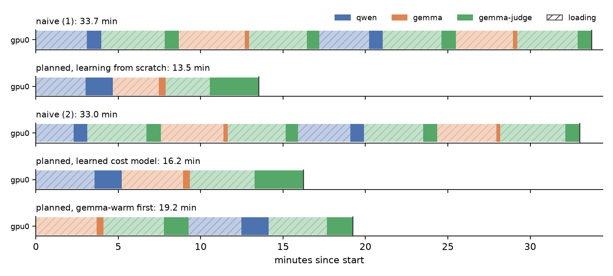

# Results

The demo in [`examples/judge_pipeline.py`](../examples/judge_pipeline.py), run with and without planning on the same
GPU, one run after another.

## The workload

Four experiments, each 300 products. In each experiment a generator writes a short advert for every product in one
style, and a judge model rates each advert from 1 to 9. A judge reply without a score is retried up to three times.

| experiment | generator | style |
|---|---|---|
| qwen-plain | Qwen3.8-27B | plain |
| gemma-plain | Gemma-4-26B-A4B | plain |
| qwen-warm | Qwen3.8-27B | warm |
| gemma-warm | Gemma-4-26B-A4B | warm |

The judge is Gemma-4-31B for every experiment, at temperature 0.1. Thinking is off for all three models, and all
three are served by vLLM with a 4096-token context and up to 192 sequences at once. That makes 2400 queries per run
and about 233,000 output tokens. Every run scored all 1200 adverts.

## The hardware

- **GPU:** one NVIDIA A100 80 GB (PCIe), on a shared server that has other users. Every run used the same GPU.
- **No scheduler:** the driver was started directly.
- **Models** are read from an NFS share. A first ("cold") load took 900–1200 s per model. Once the files were in the
  server's page cache, loads took 140–240 s. A warm-up step loaded all three models first, so every timed run below
  saw warm loads.

## The runs

Two policies:

- **Naive** is what one script per experiment does: run each experiment start to finish, loading its generator and
  then the judge. On one GPU this means 8 loads for 4 experiments.
- **Planned** is `queryplan`: it chooses which model the GPU holds and when.

The runs went in this order, on the same GPU: naive, planned (no cost model; a short pilot measures the models
first), naive again, planned with the cost model learned so far, and planned with `gemma-warm` as a top-priority
tier ahead of the other three.

| run | wall time (min) | model loads | time loading (min) | first experiment done (min) |
|---|---:|---:|---:|---:|
| naive (1) | 33.6 | 8 | 28.1 | 8.6 (qwen-plain) |
| planned, learning from scratch | 13.5 | 3 | 8.5 | 11.5 (qwen-plain) |
| naive (2) | 32.9 | 8 | 27.5 | 7.5 (qwen-plain) |
| planned, learned cost model | 16.2 | 3 | 11.2 | 14.1 (qwen-plain) |
| planned, gemma-warm first | 19.2 | 4 | 14.1 | 8.6 (gemma-warm) |

Hatched bars are loads; solid bars are serving.

### What this shows

- **Planning finished the same work 2.0–2.5× sooner** (13.5 and 16.2 min, against 32.9 and 33.6 min naive). Almost
  all of the gain is loading. The naive runs spent 28 of their 33 minutes loading models, 8 times. The planned runs
  loaded each model once: the first generator serves both of its experiments, then the second does the same, then
  the judge scores all 1200 adverts in one go.
- **A priority tier works.** With `gemma-warm` declared first, it finished after 8.6 min. In the naive runs the same
  experiment came last, at about 33 min. The cost was one extra load of the judge (4 loads instead of 3), so the
  whole run took 19.2 min rather than 13.5–16.2.
- **Serving time hardly changes.** Work is about 5 minutes of GPU time in every run. On one GPU the plan cannot
  run anything in parallel; it only removes loads.

### Predicted against actual

Each run's first plan predicts when its tiers finish.

| run | predicted (min) | actual (min) | cost model at the start |
|---|---:|---:|---|
| naive (1), (2) | 23.8 | 33.6, 32.9 | none: default 120 s loads |
| planned, learning from scratch | 13.3 | 13.5 | none: default 120 s loads and speeds |
| planned, learned cost model | 13.3 | 16.2 | learned from the runs before it |
| planned, gemma-warm first | 8.7 / 19.9 | 8.6 / 19.2 | learned from the runs before it |

With a learned cost model, the plain planned run took 22% longer than predicted. Loads explain only 38 s of the 174 s gap (672 s against the 634 s learned); the rest is serving, which the speed fit under-predicts (see Caveats). The priority run was within 4%. The near-exact
prediction for the run without a cost model is luck: its default load time is too short and its default speed too
high, and the two errors cancelled out. The naive predictions are low because those runs started without a cost
model, and the default load time is less than the real one.

## Other workload shapes (simulated)

Using the cost model measured above, the planner's own simulator predicts naive and planned wall time for other
shapes: 2, 6 or 12 experiments, 100 or 1000 items each, on 1, 2 or 4 such GPUs. Generators alternate between the two
generator models, and every experiment uses the judge. Replies are set to the measured average lengths (about 110
tokens from a generator and 90 from the judge). These are predictions, not measurements.

| experiments | items each | GPUs | naive (min) | planned (min) | speed-up | loads naive / planned |
|---:|---:|---:|---:|---:|---:|---|
| 2 | 100 | 1 | 15.3 | 11.5 | 1.32x | 4 / 3 |
| 2 | 100 | 2 | 7.7 | 7.4 | 1.05x | 4 / 3 |
| 2 | 100 | 4 | 7.7 | 4.0 | 1.94x | 4 / 4 |
| 2 | 1000 | 1 | 22.1 | 18.4 | 1.20x | 4 / 3 |
| 2 | 1000 | 2 | 11.7 | 10.2 | 1.15x | 4 / 3 |
| 2 | 1000 | 4 | 11.8 | 6.0 | 1.95x | 4 / 4 |
| 6 | 100 | 1 | 45.6 | 13.0 | 3.50x | 12 / 3 |
| 6 | 100 | 2 | 23.2 | 8.0 | 2.89x | 12 / 3 |
| 6 | 100 | 4 | 15.5 | 4.4 | 3.50x | 12 / 4 |
| 6 | 1000 | 1 | 66.2 | 33.6 | 1.97x | 12 / 3 |
| 6 | 1000 | 2 | 35.3 | 17.5 | 2.01x | 12 / 3 |
| 6 | 1000 | 4 | 23.5 | 10.6 | 2.22x | 12 / 5 |
| 12 | 100 | 1 | 91.7 | 15.3 | 5.99x | 24 / 3 |
| 12 | 100 | 2 | 46.3 | 8.9 | 5.18x | 24 / 3 |
| 12 | 100 | 4 | 23.2 | 5.1 | 4.53x | 24 / 4 |
| 12 | 1000 | 1 | 134.0 | 56.4 | 2.37x | 24 / 3 |
| 12 | 1000 | 2 | 70.5 | 30.0 | 2.35x | 24 / 4 |
| 12 | 1000 | 4 | 35.3 | 17.4 | 2.02x | 24 / 5 |

The gain grows with the number of experiments that share models, and shrinks as each experiment's own serving time
grows compared with a load. Where there is little to share, the tool does not help much. With 2 experiments on 2
GPUs, naive already gives each experiment its own GPU, and planning gains 5–15%. When a naive run leaves GPUs idle
(2 experiments on 4 GPUs), planning gains about 2× by spreading the work across them.

## Caveats

- **One run of each policy configuration**, on one GPU type. Naive was run twice and agreed to about 2%. The two
  planned runs without a priority tier differ by 2.7 min. Most of that comes from loads: the same three models
  loaded in 511 s in one run and 672 s in the other. Load times on a shared NFS server vary with what else is using
  it.
- **Every timed run had warm loads** from the page cache. With cold loads (900–1200 s each), each load the plan
  avoids saves about five times as much, so the gain would be larger, not smaller.
- **Only 1 GPU was measured.** The multi-GPU rows above are simulated. Runs on a 4-GPU cluster node are planned but
  have not been done.
- **The speed fit had little spread to work from.** Requests mostly arrived at high concurrency, so the
  half-saturation point was not measured and kept its default value, and serving came out slower than predicted. Better speed fits are the next thing to improve.
